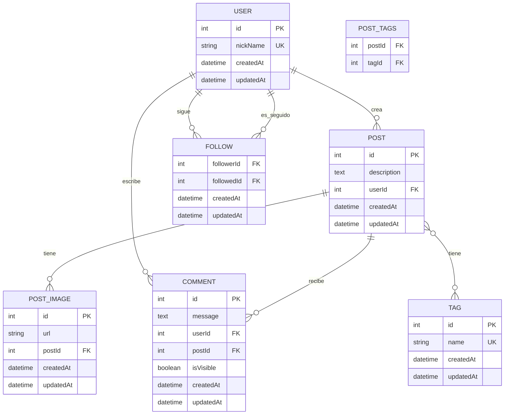

# Diagrama entidad-relación (DER)

Este diagrama resume el modelo de datos de la red social `UnaHur Anti-Social Net`.

## Descripción de relaciones

- Un `User` puede crear muchos `Post`.
- Un `User` puede escribir muchos `Comment`.
- Un `Post` puede tener muchas `PostImage`.
- Un `Post` puede recibir muchos `Comment`.
- Un `Post` puede estar asociado a muchos `Tag` mediante `Post_Tags`.
- Un `User` puede seguir a muchos otros `User` y también puede ser seguido por muchos usuarios mediante la tabla `Follows`.
- El atributo `Comment.isVisible` es virtual y no se persiste físicamente en la base de datos; se calcula según la antigüedad del comentario.
